## 👋 About Me

I'm **Jagrat**, an AI + full stack developer who likes building things people actually use, from security scanners to health tools to AI-driven games.

- 🔭 **Building:** AI applications, automation systems, modern web UIs
- 🌱 **Learning:** cloud computing, scalable backends, AI system architecture
- 🏆 **Hackathon winner**, with a habit of shipping fast and iterating
- 🔁 **Philosophy:** Build → Learn → Improve → Repeat

## 🛠️ Tech Stack

   
   
  

  
  
  

## 🚀 Featured Projects

### 🛡️ [CyberShield Executive Ops](https://github.com/JKD-codes/Cyber_security)
Web application security scanner powered by a hybrid AI + heuristic engine.
- Deep HTTP header analysis (CSP, HSTS) and active sensitive-file probing (`.env`, `.git`)
- Soft-404 detection to cut false positives; custom Python engine instead of slow LLM calls
- **Stack:** `React` `FastAPI` `Python`

### 👁️ [SafeLens AI Health Guard](https://github.com/JKD-codes/SafeLens_AI)
Local-first PWA that scans food, skincare, medicines and menus for personalized health warnings.
- On-device OCR with Tesseract.js, offline heuristics, Llama-3-70B (Groq) fallback
- Personal medical profiles; no images ever leave the device
- **Stack:** `React` `TailwindCSS` `Groq API` `Tesseract.js`

### 🕵️ Mr. Detective
AI-generated neo-noir murder mysteries with unscripted suspect interrogations.
- Procedurally generated cases (Llama 3.1 / Gemini), drag-and-drop evidence corkboard
- Live stress-level HUD, text-to-speech voices, custom Web Audio ambience, co-op mode
- **Stack:** `React` `Node.js` `Express` `MongoDB`

### 🖼️ AI Image Detector
Upload an image and get a verdict, with confidence, on whether it is AI-generated or real.
- **Stack:** `React` `TypeScript` `AI API`

## 📊 GitHub Activity

<picture>
  <source media="(prefers-color-scheme: dark)" srcset="https://raw.githubusercontent.com/JKD-codes/JKD-codes/output/pacman-contribution-graph-dark.svg" />
  
</picture>

## 🏅 Achievements

| Achievement | Result |
| --- | --- |
| 🥇 Hackathon | 1st Place |
| 🧠 Science Exhibition | 1st Place |
| 💡 Ideathon | Finalist, Innovation Award |
| ✍️ Essay Writing | Gold Medal |
| 🎤 Elocution | 2nd Place |

## 🎯 Current Goals

- Ship production-grade AI products
- Master scalable backend systems and cloud infrastructure
- Contribute to open source

